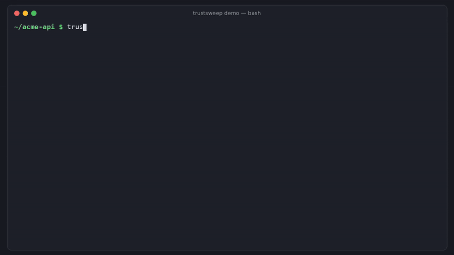

# trustsweep

[](https://github.com/hamarshehmhmd/trustsweep/actions/workflows/ci.yml)
[](LICENSE)


```bash
curl -fsSL https://raw.githubusercontent.com/hamarshehmhmd/trustsweep/main/install.sh | sh
```

Prefer not to pipe to sh? `pipx install git+https://github.com/hamarshehmhmd/trustsweep` or `uv tool install git+https://github.com/hamarshehmhmd/trustsweep`. [Read install.sh](install.sh) first if you like.



**Find every CA trust store on a machine or container image, and check them all at once.**

Your OS has a CA bundle. So does every Python virtualenv (`certifi`), pip (its own vendored copy), botocore, Java (`cacerts`) and Node (compiled in). When you add a corporate root CA, or a root gets distrusted, you have to fix *all* of them, and nothing tells you which ones you missed. trustsweep does.

```console
$ trustsweep check --require corp-root.pem --root ./rootfs
✗ 2 of 3 trust stores fail

  python-certifi  /app/.venv/lib/python3.12/site-packages/certifi/cacert.pem
    ✗ missing required CA 'Acme Corp Root CA'
      fix: certifi ignores the OS store: set REQUESTS_CA_BUNDLE/SSL_CERT_FILE, or pip install truststore to use the OS store

  java  /usr/lib/jvm/java-21-openjdk/lib/security/cacerts
    ✗ missing required CA 'Acme Corp Root CA'
      fix: keytool -importcert -cacerts -alias <name> -file ca.pem (or -delete -alias <name> to remove)
```

Zero dependencies (Python ≥ 3.9 standard library only, including its own small X.509 reader), licensed under AGPL-3.0 (commercial licenses available, see [License](#license)).

## The problem

- `curl` works but Python says `SSL: CERTIFICATE_VERIFY_FAILED`, because `requests` uses certifi's bundle, not the one you just patched in `/etc/ssl`.
- A platform team rolls out a new internal root CA. Weeks later a Java service in one image still can't reach the internal API, because its `cacerts` was never updated.
- A public root is distrusted. The OS store gets the update, but pinned `certifi` versions, pip's vendored copy and old Node binaries keep trusting it.

Each runtime has its own list and its own way to change it. trustsweep finds them all and answers one question per store: is the CA I care about in there or not?

## What it finds

| Kind | Where |
| --- | --- |
| `system` | `/etc/ssl/certs/ca-certificates.crt`, `/etc/pki/tls/certs/ca-bundle.crt`, `/etc/ssl/cert.pem` (Alpine/macOS), Homebrew OpenSSL, … |
| `python-certifi` | `*/certifi/cacert.pem` in every venv and site-packages it can find |
| `pip-vendored` | `pip/_vendor/certifi/cacert.pem` |
| `python-botocore`, `python-grpc`, `python-httplib2` | bundles shipped inside those packages |
| `java` | `*/lib/security/cacerts` (JKS keystores; PKCS#12 keystores are reported but not read yet) |
| `node-builtin` | the roots compiled into the `node` on your `PATH` |
| `env` | files named by `SSL_CERT_FILE`, `SSL_CERT_DIR`, `REQUESTS_CA_BUNDLE`, `CURL_CA_BUNDLE`, `NODE_EXTRA_CA_CERTS`, `GIT_SSL_CAINFO`, `AWS_CA_BUNDLE`, `PIP_CERT` |

It searches `~`, `/usr/lib`, `/usr/local/lib`, `/usr/share` and `/opt` by default (change with `--path DIR`), and deduplicates symlinked copies.

## Usage

```bash
trustsweep scan                                  # list every trust store on this machine
trustsweep find "ISRG Root X1"                   # which stores contain a CA (name, SHA-256 prefix or PEM file)
trustsweep find corp-root.pem
trustsweep check --require corp-root.pem         # exit 1 if any store is missing it
trustsweep check --forbid distrusted-root.pem   # exit 1 if any store still trusts a distrusted root
trustsweep check --expired --expiring-days 90    # stale or soon-to-expire roots
trustsweep diff system node                      # compare two bundles ('system', 'node' or a path)
```

Every command takes `--json` for scripts and `--kind KIND` to limit which stores are checked.

### Container images

Point `--root` at an unpacked image filesystem. Environment variables and the host's `node` are ignored in this mode.

```bash
mkdir rootfs && docker export "$(docker create my-image:latest)" | tar -x -C rootfs
trustsweep check --require corp-root.pem --root rootfs
```

### In CI

```yaml
- run: pipx install git+https://github.com/hamarshehmhmd/trustsweep
- run: trustsweep check --require certs/corp-root.pem --expired
```

## Demo

The GIF above and [`demo.mp4`](https://github.com/hamarshehmhmd/trustsweep/releases/tag/v0.1.0) (attached to the v0.1.0 release, with narration) are rendered by [`demo/render.py`](demo/render.py) from real command output. The demo image filesystem comes from [`demo/make_rootfs.py`](demo/make_rootfs.py): the host's real OS bundle plus a test corporate CA, an unpatched certifi bundle and a Java keystore.

## Limits

- It reads trust stores; it doesn't change them. The `fix:` hints tell you what to run.
- macOS Keychain and the Windows certificate store aren't read yet; on macOS it still finds Homebrew, Python, Java and Node bundles.
- Java PKCS#12 `cacerts` files are listed with an error instead of being read.

## Development

```bash
pip install -e . pytest
pytest -q
```

## License

GNU AGPL-3.0-or-later © 2026 Mohammad Hamarsheh. See [LICENSE](LICENSE).

Commercial licenses without the AGPL obligations are available from the author: open an issue or contact [@hamarshehmhmd](https://github.com/hamarshehmhmd).
